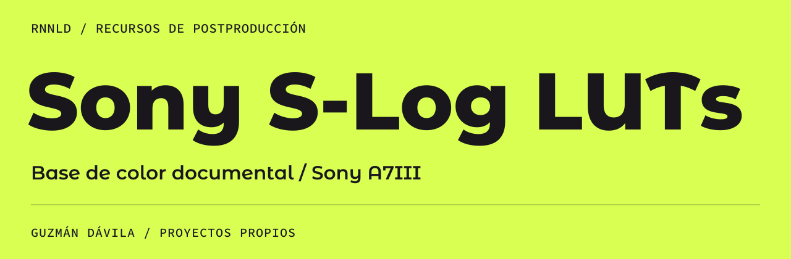

[← Perfil principal](https://github.com/guzmandavila) &nbsp; / &nbsp; [Portafolio ES](https://github.com/guzmandavila/portfolio/blob/main/PORTFOLIO_ES.md) &nbsp; / &nbsp; [Portfolio EN](https://github.com/guzmandavila/portfolio/blob/main/PORTFOLIO_EN.md)

### [Descargar LUT .cube ↓](https://raw.githubusercontent.com/guzmandavila/sony-slog-luts/main/A7III_SLOG3_REC709_DOC_BASE.cube)

Recurso de color para el flujo documental con Sony A7III. El archivo disponible es una base de trabajo para material S-Log3 y salida Rec.709; se utiliza como punto de partida para el etalonaje, con ajustes de exposición, balance y look según cada proyecto.

## Archivo disponible

| Archivo | Formato | Tamaño de la malla |
| :--- | :--- | :--- |
| [A7III_SLOG3_REC709_DOC_BASE.cube](./A7III_SLOG3_REC709_DOC_BASE.cube) | LUT 3D · .cube | 33 × 33 × 33 |

El repositorio contiene actualmente este único LUT. Las variantes S-Log2 mencionadas en versiones anteriores de la documentación no están publicadas aquí.

## Uso en postproducción

1. Descarga el archivo `.cube` e impórtalo en la biblioteca de LUTs de DaVinci Resolve.
2. Actualiza la lista de LUTs y comprueba el perfil de entrada de tu material.
3. Utilízalo como base técnica; revisa exposición y balance, y realiza después los ajustes de contraste y look.

**Flujo de referencia**  
Material S-Log3 → LUT base → Balance primario → Contraste → Look final

## Criterio de color

Respuesta cromática natural, tonos de piel neutros, saturación controlada y transiciones suaves en altas luces. Las referencias de intención cromática son Fuji y Kodak.

Cada plano requiere revisión según iluminación, exposición y dirección de fotografía. El LUT no sustituye el proceso de color grading.

## Uso y autoría

Desarrollado a partir de trabajo original de color. Uso libre en proyectos personales y profesionales; no incluye LUTs de terceros.

**Relacionado:** [portafolio de producción y postproducción](https://github.com/guzmandavila/portfolio).

---

[Perfil principal](https://github.com/guzmandavila) &nbsp; / &nbsp; [Escríbeme ↗](https://wa.me/593979864314)
